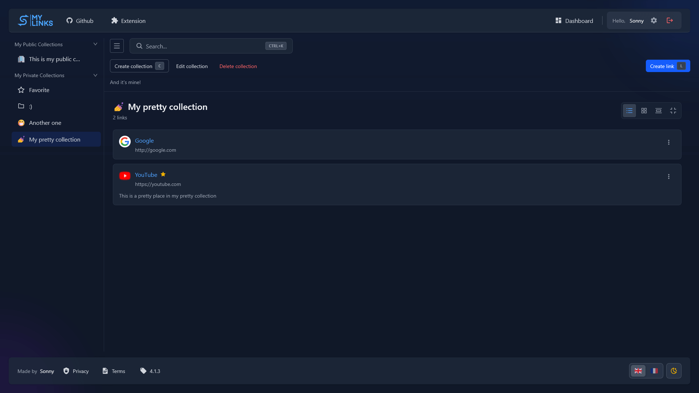

> More screenshots are available in the [`docs/public/screenshots`](./docs/public/screenshots) directory.

<div align="center">
  <h1>MyLinks</h1>
  <p>A self-hostable bookmark manager: organize, search and share your favorite links.</p>
  <p>
    <a href="https://github.com/my-links/my-links/releases/latest"></a>
    <a href="https://github.com/my-links/my-links/issues"></a>
    <a href="https://github.com/my-links/my-links/blob/main/LICENSE"></a>
  </p>
</div>

## Features

- **Collections**: group links by project or topic; a link can live in several at once, with an **Inbox** for the rest.
- **Search**: find any link or collection by name or URL.
- **Shareable collections**: a public collection is reachable with a single link, no account required on the other end.
- **Most-used links first**: opening a link counts a click, so your favorites rank themselves.
- **Browser extension**: save and search links from a side panel in Chromium and Firefox, with optional two-way syncing to your native bookmarks.
- **Privacy-focused, open-source, self-hostable**: run it on your own server and keep every link on hardware you control.

## Quickstart (Docker)

```bash
mkdir my-links && cd my-links
curl -fsSLO https://raw.githubusercontent.com/my-links/my-links/main/compose.image.yml
curl -fsSL https://raw.githubusercontent.com/my-links/my-links/main/.env.example -o .env
```

Edit `.env`: set `APP_KEY` (generate one with `openssl rand -base64 32`), `APP_URL` (the public URL of the instance), and `DB_USER`, `DB_PASSWORD` and `DB_DATABASE`. Then start it:

```bash
docker compose -f compose.image.yml up -d
docker compose -f compose.image.yml logs my-links | grep setup_token
```

The first command pulls the image from [Docker Hub](https://hub.docker.com/r/sonny93/my-links), starts PostgreSQL, applies migrations and starts the app on the port set in `PORT` (default `3333`). The second prints the setup link, `<APP_URL>/register?setup_token=<token>`: open it to create the administrator account. Sign-up stays closed to everyone else unless you set `ALLOW_REGISTRATION=open`.

See [Docker & compose](https://docs.mylinks.app/self-hosting/docker) for the details and a native (non-Docker) deployment.

## Develop

```bash
pnpm run check && just test
```

See [Contributing](CONTRIBUTING) for the setup, and `just --list` for every command.

## Links

- [Documentation](https://docs.mylinks.app): self-hosting, configuration, API reference, browser extension guide
- [Browser extension](./apps/extension/README.md): developing and building the extension
- [Changelog](https://docs.mylinks.app/changelog)
- [GitHub Issues](https://github.com/my-links/my-links/issues): bug reports and feature requests

## License

This project is licensed under the [AGPLv3 License](./LICENSE).
